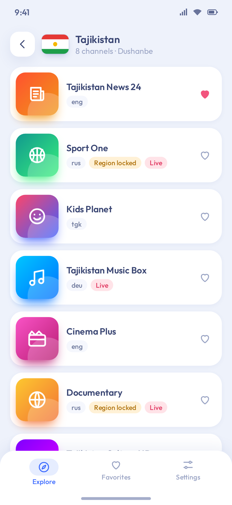
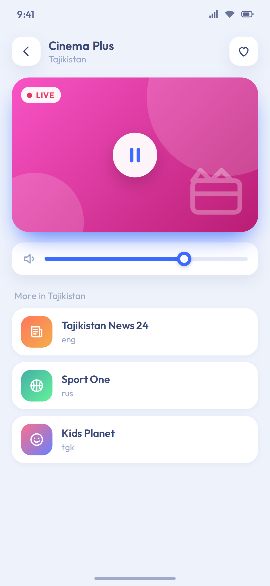
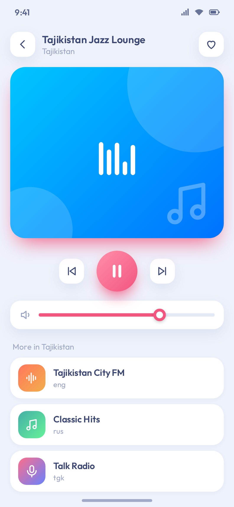
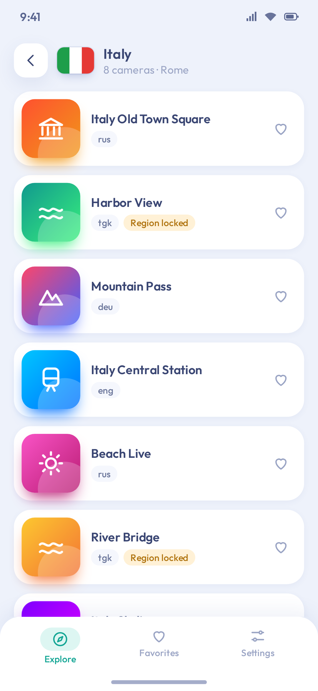
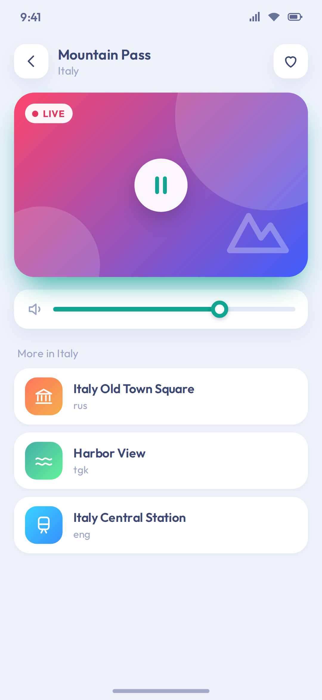
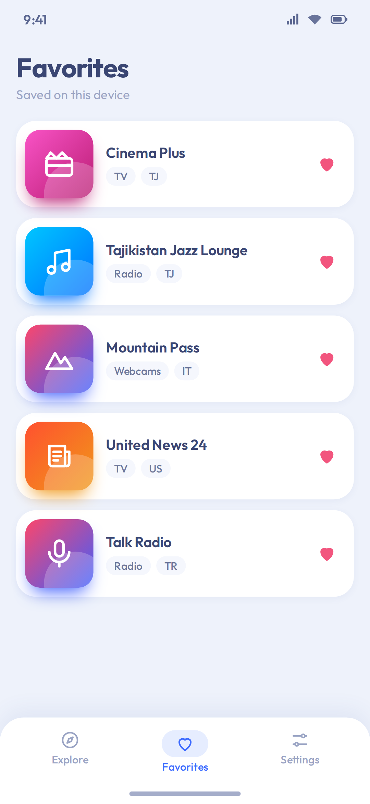
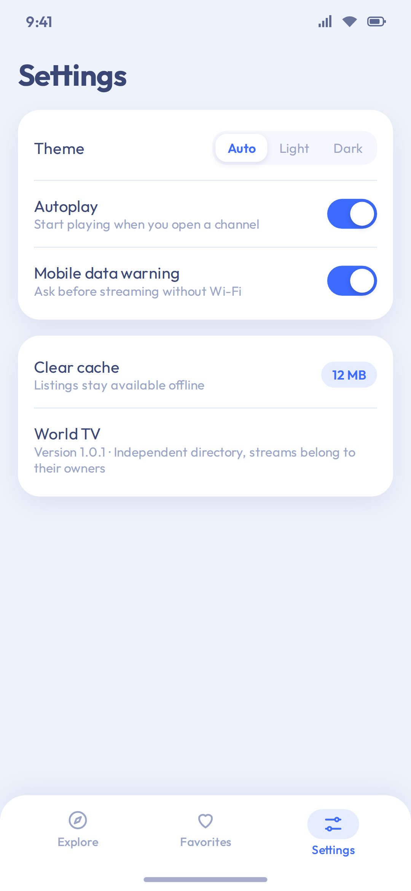

# Zenvu

Independent Android directory for live TV, online radio, and webcams. It runs on phones, Android TV, and Google TV. Zenvu does not host streams and is not an official client of the channels or of Famelack.

## Download

<!-- release:start -->
**APK 1.0.14** (2026-11-09): [Zenvu-1.0.14.apk](https://github.com/Valijonzoda/Zenvu/releases/download/v1.0.14/Zenvu-1.0.14.apk)

**AAB 1.0.14** (2026-11-09): [Zenvu-1.0.14.aab](https://github.com/Valijonzoda/Zenvu/releases/download/v1.0.14/Zenvu-1.0.14.aab)
<!-- release:end -->

A push to `master` publishes a GitHub Release. The patch version increases by `0.0.1` unless the commit message contains `version: 1.2.0` or the workflow is started manually with a version. `versionCode` is `major * 10000 + minor * 100 + patch` (1.0.11 is 10011). Minor and patch stay in 0..99 so each newer version gets a higher code. The release contains the signed APK and AAB.

## Website

- https://valijonzoda.github.io/Zenvu/
- https://valijonzoda.github.io/Zenvu/privacy/
- https://valijonzoda.github.io/Zenvu/terms/
- https://valijonzoda.github.io/Zenvu/delete-account/
- https://valijonzoda.github.io/Zenvu/dmca/
- https://valijonzoda.github.io/Zenvu/ru/
- https://valijonzoda.github.io/Zenvu/ru/privacy/
- https://valijonzoda.github.io/Zenvu/ru/terms/
- https://valijonzoda.github.io/Zenvu/ru/delete-account/
- https://valijonzoda.github.io/Zenvu/ru/dmca/

## Dataset

Listings are loaded from the public repository [Valijonzoda/famelack-data](https://github.com/Valijonzoda/famelack-data) (MIT, Copyright 2026 Famelack LLC). The app does not ship the catalog inside the APK. It downloads only the files it needs and keeps a copy on the device so listings still open offline.

Verified layout:

```text
tv|radio|webcams/
  raw/
    countries_metadata.json
    countries/{code}.json
    categories/{name}.json
  compressed/
    same paths, gzip bytes with a .json name
```

`countries_metadata.json` is an object keyed by uppercase code:

```json
{
  "AD": {
    "country": "Andorra",
    "capital": "Andorra la Vella",
    "timeZone": "Europe/Andorra",
    "hasChannels": true,
    "channelCount": 2
  }
}
```

Each country file is a JSON array. Every item uses the same fields:

```json
{
  "nanoid": "mG0AeH9doLAPIb",
  "name": "KK TV",
  "sources": {
    "streams": ["https://example.com/playlist.m3u8"],
    "youtube": ["https://www.youtube-nocookie.com/embed/VIDEO_ID"]
  },
  "languages": ["por"],
  "country": "ao",
  "isGeoBlocked": false
}
```

`sources.streams` and `sources.youtube` are optional. There is no logo field, so cards use generated artwork. TV mixes HLS or progressive streams with some YouTube embeds. Radio entries are direct audio streams. Webcam entries in the current dataset are YouTube embed URLs only.

The United Kingdom is filed as `uk`, not `gb`. Channel counts on the country list come from `channelCount`.

Zenvu requests:

- `{kind}/raw/countries_metadata.json`
- `{kind}/raw/countries/{lowercase-code}.json`

Base URL: `https://raw.githubusercontent.com/Valijonzoda/famelack-data/main/`

To point the app at your own fork, set `datasetBase` in `gradle.properties`:

```properties
datasetBase=https://raw.githubusercontent.com/YOUR_USER/famelack-data/main/
```

## Architecture

- `domain` models, filtering, playback planning, repository interfaces
- `data` JSON parsing, OkHttp downloads, file cache, DataStore settings, Firebase account and favorites
- `ui` Material 3 phone layout and a separate D-pad layout for television
- `playback` Media3 ExoPlayer for HLS and progressive audio/video, plus a foreground media session for radio

Direct streams play in ExoPlayer. YouTube embed URLs open in a WebView. If every address fails, the player explains that the source may be offline, region locked, or unsupported. `isGeoBlocked` is shown before playback; the app still tries the stream.

Watching does not require an account. Favorites are stored in Cloud Firestore after sign-in and cached on the device. Theme, playback preferences, and the last country selection stay on the device.

## Accounts

Sign-in uses Firebase Authentication (email and password, plus Google Sign-In when a web client id is present). Favorites for a signed-in user live at `users/{uid}/favorites/{channelId}` in Cloud Firestore. Rules are in `firestore.rules`. The app enables Firestore’s offline cache. Without `app/google-services.json` the debug build still succeeds and sign-in stays off.

1. In the Firebase console, create a project and add an Android app with package name `com.worldtv.app`.
2. Enable Authentication → Email/Password. For Google Sign-In, enable the Google provider and add the SHA-1 and SHA-256 of the debug keystore and of the Play upload key (`./gradlew :app:signingReport`).
3. Download `google-services.json` into `app/google-services.json`. Do not commit it. After the SHA fingerprints are saved, download the file again so it contains an OAuth web client (`client_type` 3). Until that client id exists, the Google button stays hidden and email sign-in still works.
4. Create a Firestore database and publish `firestore.rules`.
5. For GitHub Actions, store the file as a Base64 secret named `GOOGLE_SERVICES_JSON` (`base64 -w 0 app/google-services.json`). The workflow decodes it before the build. If the secret is missing, the build still runs and accounts stay disabled.

Account deletion in the app is Settings → Account → Delete account. The public deletion page is https://valijonzoda.github.io/Zenvu/delete-account/. Play Data safety answers are in `play/data-safety.md`.

## Build

Install JDK 17 and Android SDK 36, then:

```bash
./gradlew test assembleDebug
```

`assembleDebug` uses the debug certificate and does not need the upload key. `assembleRelease` and `bundleRelease` stop with an error until the four signing variables below are set.

## Release signing

Published APKs must share one upload certificate. Android refuses an update signed with a different certificate and reports that the package conflicts with an existing package. Create the keystore once and keep using it.

`keytool` asks for the password twice and then for your name. Type the same password both times. PKCS12 keeps one password, and a current JDK ignores a different key password. The legacy flag writes a keystore the Android build tools can read. Without it, packaging fails with `Tag number over 30 is not supported`.

```bash
keytool -genkeypair -v \
  -keystore zenvu-release.keystore \
  -storetype PKCS12 \
  -alias zenvu \
  -keyalg RSA \
  -keysize 2048 \
  -sigalg SHA256withRSA \
  -validity 10000 \
  -J-Dkeystore.pkcs12.legacy
```

Do not commit the keystore or the passwords. `*.keystore`, `*.jks`, and `keystore.properties` are ignored.

Local release build. `KEYSTORE_PASSWORD` and `KEY_PASSWORD` are both that one password:

```bash
export KEYSTORE_FILE="$PWD/zenvu-release.keystore"
export KEYSTORE_PASSWORD="the keystore password"
export KEY_ALIAS="zenvu"
export KEY_PASSWORD="the keystore password"
./gradlew assembleRelease bundleRelease -PversionName=1.0.11 -PversionCode=10011
```

GitHub Actions secrets, in the repository under Settings → Secrets and variables → Actions:

| Secret | Value |
| --- | --- |
| `KEYSTORE_BASE64` | output of `base64 -w 0 zenvu-release.keystore` |
| `KEYSTORE_PASSWORD` | the keystore password |
| `KEY_ALIAS` | alias, for example `zenvu` |
| `KEY_PASSWORD` | the same keystore password |

The release job writes the decoded keystore under the runner temp directory, passes that path as `KEYSTORE_FILE`, and deletes the file at the end. Pull requests only run unit tests. A push to `master` publishes the signed release APK and AAB. The debug APK is not attached to the release. After the build, the log prints `Release certificate SHA-256:` from `apksigner verify --print-certs`. Add that SHA-256 in Firebase if you use Google Sign-In (`./gradlew :app:signingReport` prints the same certificate when the four variables are set).

Keep a copy of `zenvu-release.keystore` together with the alias and the password. Put the file on an encrypted disk and a second offline copy, and store the passwords in a password manager. GitHub cannot show a secret again after you save it. Losing this key means every installed copy has to be removed before a new key can be used.

A different upload key is a different app to Android. Users uninstall Zenvu and install the new build. Uninstalling clears on-device settings. An account in Firebase remains and comes back after sign-in. Builds published before this signing setup used a debug certificate that changed on every CI runner, so the first build signed with the upload key also needs that one uninstall. After that, later releases install over the existing app.

## Rights

The dataset license allows reuse of the listing data. That license does not make the third-party streams official or owned by Zenvu. Some streams are region locked. See https://valijonzoda.github.io/Zenvu/privacy/ before publishing to Google Play.

Outfit is included under the SIL Open Font License. See `third_party/outfit/OFL.txt`.


## Screenshots

<table>
<tr>
<td></td>
<td></td>
<td></td>
<td></td>
</tr>
<tr>
<td></td>
<td></td>
<td></td>
</tr>
</table>
